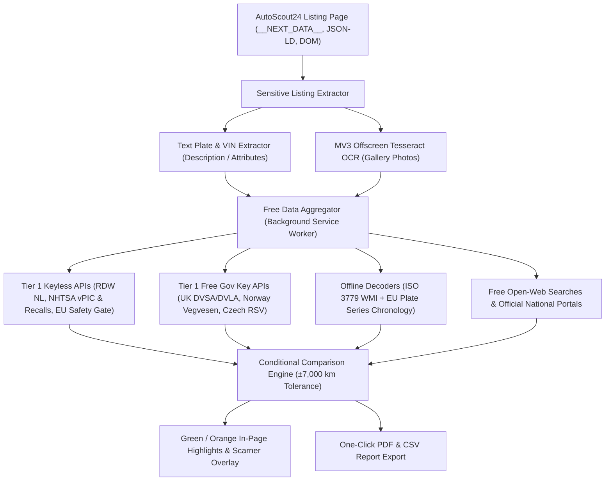

# Scarner Wiki — Home

Welcome to the **Scarner** technical wiki. Scarner is a **100% free, open-source Chrome Extension (Manifest V3)** that verifies used vehicle listings on **AutoScout24** across Europe using open government APIs, offline cryptographic/chronological decoders, client-side license plate OCR, and free official verification portals — **with zero paid APIs or subscriptions**.

## Wiki Navigation

1. **[Master Vehicle Data Map](./Vehicle-Data-Map.md)**
   Complete field-by-field mapping of every vehicle attribute, where it can be found online for free, how it is accessed (REST API, XML feed, offline decoder, open-web footprint, or free government portal), and what input key is required.
2. **[European Free Sources Directory (20 Countries)](./European-Free-Sources-Directory.md)**
   Country-by-country directory of Tier 1 free government APIs and Tier 2 official free web portals across Europe.
3. **[Verification Rules, ±7,000 km Tolerance & Conditional Language](./Verification-Rules-And-Conditional-Language.md)**
   How Scarner extracts sensitive AutoScout24 listing claims, compares them against external databases, highlights matches in **green** and discrepancies in **orange**, and enforces strictly conditional phrasing.
4. **[Anonymous Usage Telemetry on GitHub](./Telemetry-And-GitHub-Storage.md)**
   How Scarner tracks anonymous plugin usage metrics (with user opt-out) and persists aggregated statistics directly in this GitHub repository via GitHub Actions.

---

## High-Level Data Pipeline

