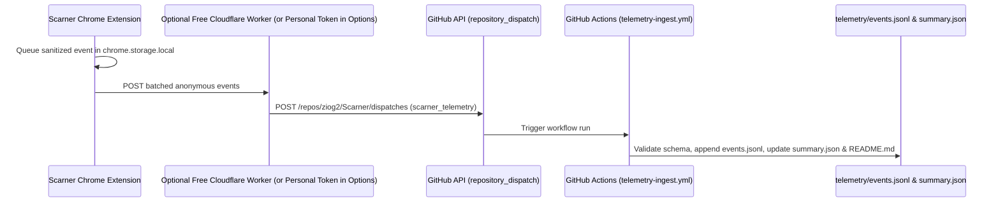

# Anonymous Usage Telemetry & GitHub Storage

Scarner includes a transparent, privacy-preserving usage telemetry pipeline capable of storing aggregated plugin activity directly inside this GitHub repository (`telemetry/`).

---

## 1. Privacy & Data Minimization Principles

1. **Zero Personal Identifiable Information (PII)**: Scarner **never** collects user names, emails, IP addresses, browsing history outside supported vehicle listings, seller phone numbers, or raw license plates/VINs.
2. **Irreversible Hashing**: To count unique vehicles analyzed without revealing any vehicle's license plate or VIN, identifiers are hashed locally using `SHA-256` with a short truncated prefix (`8 hex chars`) before queuing.
3. **User Control**: Anonymous telemetry can be toggled on or off at any time in the Scarner Extension Popup/Options, and the local event log can be inspected or cleared in one click.

---

## 2. Tracked Event Schema

Each anonymous event conforms to `TelemetryEvent` (`src/telemetry/telemetry.ts`):

```json
{
  "eventType": "listing_analyzed",
  "date": "2026-11-24",
  "marketplace": "autoscout24.it",
  "country": "IT",
  "vehicleMake": "VOLKSWAGEN",
  "vehicleModel": "GOLF",
  "registrationYear": 2021,
  "detectionMethod": "plate_ocr",
  "greenCount": 5,
  "orangeCount": 1,
  "recallsCount": 1,
  "extensionVersion": "1.0.0"
}
```

Supported `eventType` values:
- `listing_analyzed`
- `ocr_plate_found`
- `export_pdf`
- `export_csv`

---

## 3. How Telemetry Is Saved on GitHub

Because a public Chrome Extension must **never** embed a hardcoded GitHub token in client code (GitHub secret scanning immediately revokes exposed tokens, and anyone could abuse write access), Scarner implements a clean two-layer GitHub storage architecture:



### Files in the Repository
- [`.github/workflows/telemetry-ingest.yml`](../.github/workflows/telemetry-ingest.yml): GitHub Actions workflow triggered by `repository_dispatch` (`scarner_telemetry`) or manual `workflow_dispatch`.
- [`scripts/ingest-telemetry.mjs`](../scripts/ingest-telemetry.mjs): Schema validator and aggregator that updates `telemetry/events.jsonl`, `telemetry/summary.json`, and `telemetry/README.md`.
- [`telemetry/cloudflare-worker-relay.js`](../telemetry/cloudflare-worker-relay.js): Ready-to-deploy 60-line free Cloudflare Worker that holds the repository-scoped `GITHUB_TOKEN` server-side so public extension users can submit anonymous telemetry safely without client secrets.
